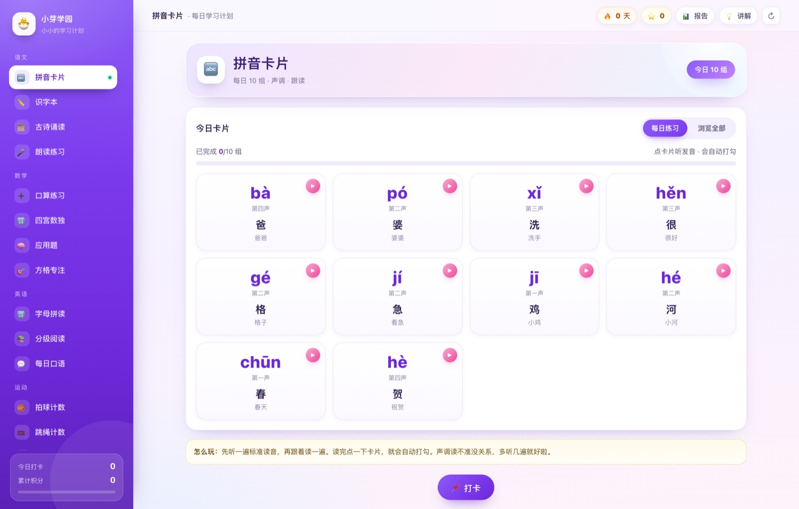

# 小芽学园 · 每日学习计划

一套给 5～7 岁孩子用的离线学习计划。语文、数学、英语、运动、兴趣五大类共 17 个练习，加上学习数据、科学小知识、设置与数据、打卡日历，共 21 个页面，打开就能用。

**所有内容、题目、统计都在本地运行**：不需要账号，不联网，不上传任何数据。

[](LICENSE)


**在线直接使用**：<https://c19519980404-beep.github.io/xiaoya-academy/>



---

## 一、快速开始

### macOS

1. 把整个 `小芽学园` 文件夹放到桌面或文档里（不要放在下载临时目录）。
2. 双击 **`start-mac.command`**。
3. 浏览器会自动打开 `http://127.0.0.1:8123/`，开始使用。

> 第一次打开如果提示"无法验证开发者"：右键点击 `start-mac.command` → 选择"打开" → 再点"打开"。
> 如果双击只弹出一个文本窗口：在"终端"里执行一次 `chmod +x start-mac.command` 即可。

### Windows

1. 把整个文件夹解压到任意位置（路径尽量不要有特殊符号）。
2. 双击 **`start-windows.bat`**。
3. 浏览器会自动打开 `http://127.0.0.1:8123/`。

> 如果出现"Windows 已保护你的电脑"：点"更多信息" → "仍要运行"。
> 脚本会自动寻找 `py` / `python` / `node` 来启动本地服务；都没有时会直接打开网页文件。

### 不想用启动脚本

直接双击 **`index.html`** 也能用（推荐 Chrome / Edge）。
这种方式下数据仍然保存在浏览器里，但个别浏览器（如部分版本的 Safari）会限制本地文件的存储，建议还是用启动脚本。

---

## 二、页面一览

左侧是六个大类，点开就能进入具体的练习：

| 分类 | 练习 | 能做什么 |
| --- | --- | --- |
| 语文 | 拼音卡片 | 每日 10 组声调卡片，点卡片听读音、自动打勾；可按一声～四声筛选浏览全部 53 个音节 |
| 语文 | 识字本 | 36 个常用字，部首、笔画、组词、例句，认识/不认识分开管理 |
| 语文 | 古诗诵读 | 10 首必背古诗，逐句朗读、慢速跟读、诗意讲解、阅读进度 |
| 语文 | 朗读练习 | 自由录入或粘贴文本，整篇朗读，保存多篇作品 |
| 数学 | 口算练习 | 20 以内加减，20 题一组，计时 + 自动批改 + 凑十法/破十法提示，成绩入库 |
| 数学 | 四宫数独 | 4×4 数独，简单/挑战两档，检查、提示、计时 |
| 数学 | 应用题 | 20 道生活应用题，提交判分、提示、解析，错题入错题本 |
| 数学 | 方格专注 | 5×5 方格，5 组独立计时，记录最好成绩 |
| 英语 | 字母拼读 | 26 字母发音 + CVC 拼词练习，三档语速跟读 |
| 英语 | 分级阅读 | AA–C 级短文，整篇朗读、慢速跟读、中文对照、已读标记 |
| 英语 | 每日口语 | 每日 10 句亲子口语，听读 + 回答参考 |
| 运动 | 拍球计数 / 跳绳计数 | 计数器，+1/−1、自动计时、目标进度、最佳成绩 |
| 运动 | 每日体能 | 6 项运动清单，完成打勾，每天自动重置 |
| 运动 | 平衡练习 | 8 组平衡与协调练习，含做法说明与建议时长 |
| 兴趣 | 游泳进阶 | 4 种泳姿 0～5 级，升级记录、打卡 |
| 兴趣 | 节拍练习 | 节拍器（50–160 BPM）、4/4 拍可视化、跟拍计数 |
| 更多 | 学习数据 | 做题看板：KPI、7 天趋势图、打卡分布、口算成绩、方格专注、错题本、学习建议 |
| 更多 | 科学小知识 | 8 篇生活科普 + 小问答，答对记积分 |
| 更多 | 设置与数据 | 个人资料、语音设置、数据导出/导入/演示/清空 |
| 更多 | 打卡日历 | 月历打卡视图、当月统计、月末总结、当日打卡项 |

---

## 三、做题数据是怎么记的

- **口算练习**：点"自动批改"后记录题量、答对数、正确率、用时、每分钟题数；答错的题自动进入错题本（含题目、你的答案、正确答案）。
- **应用题 / 科学小知识**：提交即判分，答错自动进错题本。
- **四宫数独 / 方格专注 / 拍球 / 跳绳**：完成即记录用时或成绩。
- **拼音 / 识字 / 古诗 / 字母拼读 / 分级阅读 / 每日口语**：点卡片、点"认识"或"看答案"就记进度。
- **打卡**：每个练习每天第一次打卡 +5 积分，连续打卡天数显示在右上角。
- 所有记录都能在 **更多 → 学习数据** 里看到；在 **打卡日历** 里点任意一天，可以看当天具体做了什么。

想先看看图表长什么样：进入"设置与数据 → 生成演示数据"，会写入最近 6 天的示例记录（之后可"清空全部数据"恢复干净状态）。

---

## 四、数据保存在哪里

- 保存在**这台设备的浏览器**里（localStorage），换设备不会自动同步。
- 清理浏览器缓存、换浏览器、换电脑前，请到 **设置与数据 → 导出备份**，得到一个 `小芽学园-学习数据-YYYY-MM-DD.json`。
- 在新设备上 **设置与数据 → 导入备份** 即可完整恢复。
- 数据只在本机，没有任何服务器，也没有账号体系。

---

## 五、部署到线上

这是纯静态站点，不需要后端、不需要数据库，任何静态托管都能放：

- **GitHub Pages（已开启）**：本仓库已配置 Pages，地址 <https://c19519980404-beep.github.io/xiaoya-academy/>。
  Fork 后到 Settings → Pages，Source 选择 `Deploy from a branch` → `main` → `/ (root)` 即可得到自己的链接。
- **Vercel / Netlify**：导入仓库或把整个文件夹拖进去，入口 `index.html`，无需构建命令。
- **内网 / 自己的服务器**：把文件夹放到 nginx 的 html 目录。
- **本机临时分享**：在文件夹里执行 `python3 -m http.server 8080` 或 `npx serve .`。

部署后同一个链接在 Windows、macOS、手机、平板上都能打开，数据各自保存在各自设备的浏览器里。

---

## 六、目录结构

```
小芽学园/
├── index.html                 入口页面
├── assets/
│   ├── css/app.css            全部样式（紫色侧栏 · 渐变卡片 · 响应式）
│   └── js/
│       ├── data.js            课程内容库（拼音/识字/古诗/题库/短文…）
│       ├── store.js           本地存储 + 学习数据统计
│       ├── ui.js              弹窗、提示、模块注册等通用工具
│       ├── speech.js          浏览器语音朗读
│       ├── app.js             侧栏导航与路由
│       └── modules/           21 个功能模块
├── server.js                  零依赖本地服务器（Node 备用）
├── start-mac.command          macOS 启动脚本
├── start-windows.bat          Windows 启动脚本
└── README.md
```

---

## 七、常见问题

**1. 点朗读没有声音？**
先检查系统音量和静音键。Windows 需要在"设置 → 时间和语言 → 语音"里安装中文语音包；macOS 一般自带。也可以到"设置与数据 → 语音设置"点"试听中文/英文"确认。语音用的是系统 TTS，不消耗流量。

**2. 换电脑后数据没了？**
数据存在浏览器里，不会跟着文件走。用"导出备份 / 导入备份"迁移。

**3. 提示端口被占用？**
说明 8123 已被别的程序使用。可以关掉占用程序，或直接用浏览器打开 `index.html`。也可以用 Node 指定端口：`PORT=9000 node server.js`。

**4. 双击 `.command` 没反应？**
在"终端"里 `cd` 到该文件夹，执行 `chmod +x start-mac.command`，再双击。或者直接双击 `index.html`。

**5. 孩子误删了记录？**
单条错题可以单独移除；整体误操作只能在"设置与数据"重新导入之前的备份。建议每周导出一次备份。

**6. 手机上能用吗？**
可以。页面是响应式的，手机浏览器打开后可以"添加到主屏幕"，像 App 一样使用。电脑上启动的服务，手机通过同一 Wi-Fi 访问 `http://电脑IP:8123/` 也能打开（需把 server.js 的监听地址改为 `0.0.0.0`）。

---

## 八、给家长的使用建议

- 每天 15～25 分钟足够，语文 + 数学 + 英语各一个练习，再加一项运动。
- 口算先求准，再求快；正确率稳定在 90% 以上再提速。
- 错题本每周回看一次，比重做十套新题更有用。
- 打卡是给坚持的奖励，不要因为断一天就放弃。

---

## 九、开源协议

本项目使用 [MIT License](LICENSE)，你可以自由使用、修改、二次分发，包括商业用途，保留版权声明即可。

如果这个项目帮到了你，欢迎点一个 Star ⭐，也欢迎把它改成适合自己家孩子的版本。

## 十、参与贡献

- **加内容**：所有课程内容集中在 `assets/js/data.js`，按现有格式补充拼音、识字、古诗、题库、英文短文、运动项目、科普问答即可，不需要改逻辑。
- **加模块**：在 `assets/js/modules/` 新建文件，用 `Modules.register(id, { icon, title, subtitle, badge, render })` 注册，再到 `index.html` 引入脚本、`assets/js/app.js` 的 `NAV` 里加一项。
- **改样式**：全部样式在 `assets/css/app.css`，颜色集中在 `:root` 变量里，改一处即可换主题。
- **提交前自测**：用 Chrome 打开 `index.html`，把改动的模块点一遍，确认控制台没有报错。

## 十一、适合谁用

- 家里有 5～7 岁孩子、想安排每日学习但不想下载一堆 App 的家长
- 想给孩子做一个专属学习页面的老师
- 想找一个「纯前端 + localStorage」完整案例的开发者

没有账号体系、没有埋点、没有广告，也不需要联网。
